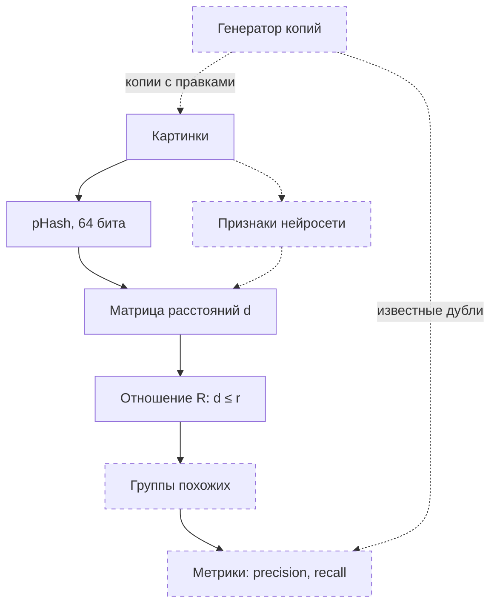

# image-dup-search

Поиск дубликатов изображений и построение классов визуального сходства.
Проект альтернативного экзамена по дисциплине "Комбинаторика и теория графов", СПбГЭТУ «ЛЭТИ», осень 2026.

## Идея

Каждой картинке сопоставляется признак — пока хэш pHash (64 бита).
Две картинки находятся в отношении похожести R, если расстояние Хэмминга d между их хэшами не больше порога `r`:

```
R(a, b)  ⇔  d(a, b) ≤ r
```

R рефлексивно и симметрично, но не обязано быть транзитивным.
Поэтому классы похожих картинок приходится строить, и разные способы построения дают разные группы. Это и исследуется.

## Возможности

- **Матрица расстояний:** попарные расстояния Хэмминга между pHash картинок.
- **Отношение похожести:** матрица R при пороге `r` — `1`, если картинки похожи.
- **Эксперимент с поворотом:** скрипт поворачивает фотографию на 0–15° и печатает обе матрицы.

## Стек

- **Python:** 3.12+
- **Картинки:** `Pillow` — открытие и поворот, `ImageHash` — pHash
- **Вычисления:** `NumPy`
- **Разработка:** `pytest`, `ruff`, `black`, `mypy`, GitHub Actions

## Пайплайн



Сплошная рамка — уже в коде, пунктирная — в планах.

## Структура проекта

```
image-dup-search/
├── src/dup_search/
│   ├── matrix.py               # матрица попарных расстояний Хэмминга
│   └── similarity_relation.py  # матрица отношения R при пороге r
├── scripts/
│   └── explore_rotations.py    # эксперимент: pHash и поворот фотографии
├── tests/
│   └── test_symmetry.py        # нули на диагонали, симметрия матрицы
├── data/                       # картинки; создаётся скриптом, в git не попадает
├── results.md                  # журнал экспериментов
├── pyproject.toml              # зависимости и настройки инструментов
└── .github/workflows/ci.yml    # CI: ruff, black, mypy, pytest
```

## Результаты

Первый эксперимент — одна фотография, повёрнутая на 0–15°:

- Поворот на 3° уже меняет pHash на 4 бита из 64, а с ростом угла расстояние растёт неравномерно.
- Отношение R транзитивно только на крайних порогах. При 8 ≤ r ≤ 21 цепочки похожих пар собирают все версии фотографии в одну группу, хотя 0° и 15° не похожи: группа — ещё не класс похожих картинок.

Матрицы и объяснения — в [results.md](results.md).

## Ограничения и планы

- **Масштаб:** матрица строится двойным циклом на чистом Python — для 10 000 картинок это 10⁸ сравнений. Ускорение на NumPy — вместе с переходом к большой коллекции.
- **Данные:** MIRFLICKR-25000 как фон и вставленные в него копии с правками (пересжатие JPEG, уменьшение, кроп, яркость, поворот на 90°); INRIA Copydays и Holidays — проверка на готовой разметке.
- **Признаки:** признаки нейросети и сравнение с pHash.
- **Группировка:** компоненты связности, клики, иерархическая кластеризация.

## Установка

```bash
git clone https://github.com/kazumasatovich/image-dup-search.git
cd image-dup-search
python3 -m venv .venv
source .venv/bin/activate
pip install -e ".[dev]"
```

## Запуск эксперимента

Из корня репозитория:

```bash
./scripts/explore_rotations.py data/photo.jpg 8
```

| Аргумент | Пример | Что это |
|---|---|---|
| `image_path` | `data/photo.jpg` | путь к фотографии |
| `threshold` | `8` | порог `r` в битах, целое число |

Скрипт сохраняет в `data/` шесть версий фотографии — от `photo_rot0.jpg` до `photo_rot15.jpg`, повёрнутых на 0, 3, 6, 9, 12 и 15°, — и печатает две матрицы: расстояния Хэмминга между их pHash и отношение R (`1` — похожи).

## Проверки

Те же, что запускает CI:

```bash
ruff check .
black --check .
mypy src scripts tests
pytest
```

## Частые ошибки

Скрипт проверяет аргументы и путь к файлу до того, как открыть картинку.

#### `ModuleNotFoundError: No module named 'dup_search'`
- **Код возврата:** 1
- **Причина:** пакет не установлен в окружение, из которого запущен скрипт: не активирован `.venv` или не выполнен `pip install -e`.
- **Решение:** `source .venv/bin/activate`, затем `pip install -e ".[dev]"`.

#### `error: the following arguments are required: image_path, threshold`
- **Код возврата:** 2
- **Причина:** не передан путь к фотографии или порог.
- **Решение:** передайте оба аргумента, как в разделе «Запуск эксперимента».

#### `Ошибка: файл 'data/photo.jpg' не найден.`
- **Код возврата:** 1
- **Причина:** по указанному пути нет файла. Путь считается от текущей папки, а не от папки скрипта.
- **Решение:** проверьте путь и запускайте скрипт из корня репозитория.

#### `ValueError: invalid literal for int() with base 10: '8.5'`
- **Код возврата:** 1
- **Причина:** порог — не целое число.
- **Решение:** передайте целый порог, например `8`.