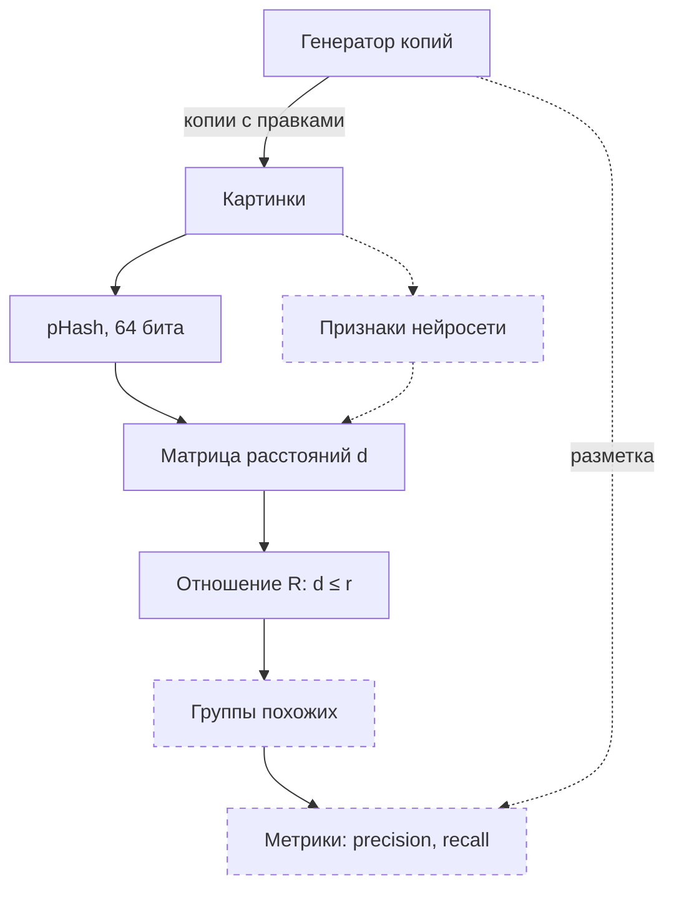

# image-dup-search

Поиск дубликатов изображений и построение классов визуального сходства.
Проект альтернативного экзамена по дисциплине "Комбинаторика и теория графов", СПбГЭТУ «ЛЭТИ», осень 2026.

## Идея

Каждой картинке сопоставляется признак — пока хэш pHash (64 бита).
Две картинки находятся в отношении похожести R, если расстояние Хэмминга d между их хэшами не больше порога `r`:

```
R(a, b)  ⇔  d(a, b) ≤ r
```

R рефлексивно и симметрично, но не обязано быть транзитивным.
Поэтому классы похожих картинок приходится строить, и разные способы построения дают разные группы. Это и исследуется.

## Возможности

- **Матрица расстояний:** попарные расстояния Хэмминга между pHash картинок.
- **Отношение похожести:** матрица R при пороге `r` — `1`, если картинки похожи.
- **Эксперимент с поворотом:** скрипт поворачивает фотографию на 0–15° и печатает обе матрицы.
- **Генератор копий:** делает из оригинала копии, к каждой применяет одну правку — пересжатие JPEG, уменьшение, кроп, яркость, поворот или размытие — и записывает разметку: из какого оригинала копия, какая правка и с каким параметром.
- **Сборка набора:** скрипт берёт случайные фото из MIRFLICKR-25000, делает из каждого копии и складывает картинки и разметку в одну папку.

## Стек

- **Python:** 3.12+
- **Картинки:** `Pillow` — открытие, правки и сохранение, `ImageHash` — pHash
- **Вычисления:** `NumPy`
- **Разработка:** `pytest`, `ruff`, `black`, `mypy`, GitHub Actions

## Пайплайн



Сплошная рамка — уже в коде, пунктирная — в планах.

## Структура проекта

```
image-dup-search/
├── src/dup_search/
│   ├── matrix.py               # матрица попарных расстояний Хэмминга
│   ├── similarity_relation.py  # матрица отношения R при пороге r
│   └── generator.py            # правки, генератор копий и разметка
├── scripts/
│   ├── explore_rotations.py    # эксперимент: pHash и поворот фотографии
│   └── make_set.py             # сборка набора из MIRFLICKR-25000
├── tests/
│   ├── test_symmetry.py        # нули на диагонали, симметрия матрицы
│   └── test_generator.py       # правки, имена файлов, разметка, воспроизводимость
├── data/                       # картинки эксперимента с поворотом; в git не попадает
├── results.md                  # журнал экспериментов
├── pyproject.toml              # зависимости и настройки инструментов
└── .github/workflows/ci.yml    # CI: ruff, black, mypy, pytest
```

## Результаты

Первый эксперимент — одна фотография, повёрнутая на 0–15°:

- Поворот на 3° уже меняет pHash на 4 бита из 64, а с ростом угла расстояние растёт неравномерно.
- Отношение R транзитивно только на крайних порогах. При 8 ≤ r ≤ 21 цепочки похожих пар собирают все версии фотографии в одну группу, хотя 0° и 15° не похожи: группа — ещё не класс похожих картинок.

Матрицы и объяснения — в [results.md](results.md).

## Ограничения и планы

- **Масштаб:** матрица строится двойным циклом на чистом Python — для 10 000 картинок это 10⁸ сравнений. Ускорение на NumPy — вместе с переходом к большой коллекции.
- **Данные:** INRIA Copydays и Holidays — проверка на готовой разметке.
- **Пороги:** что считать дублем, а что визуальным сходством, решают пороги на силу правки; подбираются вместе с метриками.
- **Признаки:** признаки нейросети и сравнение с pHash.
- **Группировка:** компоненты связности, клики, иерархическая кластеризация.

## Установка

```bash
git clone https://github.com/kazumasatovich/image-dup-search.git
cd image-dup-search
python3 -m venv .venv
source .venv/bin/activate
pip install -e ".[dev]"
```

## Запуск эксперимента

Из корня репозитория:

```bash
./scripts/explore_rotations.py data/photo.jpg 8
```

| Аргумент | Пример | Что это |
|---|---|---|
| `image_path` | `data/photo.jpg` | путь к фотографии |
| `threshold` | `8` | порог `r` в битах, целое число |

Скрипт сохраняет в `data/` шесть версий фотографии — от `photo_rot0.jpg` до `photo_rot15.jpg`, повёрнутых на 0, 3, 6, 9, 12 и 15°, — и печатает две матрицы: расстояния Хэмминга между их pHash и отношение R (`1` — похожи).

## Сборка набора

Картинки лежат вне репозитория, путь к ним задаёт переменная окружения `DUP_SEARCH_DATA`. Архив MIRFLICKR-25000 распаковывается в `$DUP_SEARCH_DATA/mirflickr`.

```bash
export DUP_SEARCH_DATA="$HOME/datasets"
./scripts/make_set.py set100
```

| Аргумент | По умолчанию | Что это |
|---|---|---|
| `name` | — | имя набора |
| `--originals` | `20` | сколько оригиналов взять из MIRFLICKR |
| `--copies` | `4` | сколько копий сделать из каждого оригинала, от 0 до 6; правки у копий одного оригинала разные |
| `--seed` | `0` | зерно случайного выбора: с тем же зерном набор собирается заново таким же |

Набор появляется в `$DUP_SEARCH_DATA/sets/<имя>/`: картинки в `images/`, разметка в `markup.csv`. Все картинки сохраняются в PNG, имена — перемешанные номера (`0042.png`), поэтому ни расширение, ни имя, ни порядок файлов не выдают, кто чья копия.

`markup.csv` — по строке на каждую картинку набора:

| Колонка | Что это |
|---|---|
| `file` | имя картинки |
| `source` | имя оригинала, из которого сделана картинка; у оригинала — своё |
| `op` | правка: `jpeg`, `scale`, `crop`, `brightness`, `rotate`, `blur`; у оригинала — `orig` |
| `param` | параметр правки; у оригинала пусто |
| `origin` | имя файла в MIRFLICKR; только у оригиналов |

Что означает `param` у каждой правки и в каком диапазоне он выбирается — в докстринге и словаре `EDITS` в `src/dup_search/generator.py`. Метку «дубль или нет» разметка не хранит: её считает функция от `op` и `param` с порогами при подсчёте метрик.

## Проверки

Те же, что запускает CI:

```bash
ruff check .
black --check .
mypy src scripts tests
pytest
```

## Частые ошибки

Скрипты проверяют аргументы и пути до того, как открыть картинки.

### Оба скрипта

#### `ModuleNotFoundError: No module named 'dup_search'`
- **Код возврата:** 1
- **Причина:** пакет не установлен в окружение, из которого запущен скрипт: не активирован `.venv` или не выполнен `pip install -e`.
- **Решение:** `source .venv/bin/activate`, затем `pip install -e ".[dev]"`.

### explore_rotations.py

#### `error: the following arguments are required: image_path, threshold`
- **Код возврата:** 2
- **Причина:** не передан путь к фотографии или порог.
- **Решение:** передайте оба аргумента, как в разделе «Запуск эксперимента».

#### `Ошибка: файл 'data/photo.jpg' не найден.`
- **Код возврата:** 1
- **Причина:** по указанному пути нет файла. Путь считается от текущей папки, а не от папки скрипта.
- **Решение:** проверьте путь и запускайте скрипт из корня репозитория.

#### `ValueError: invalid literal for int() with base 10: '8.5'`
- **Код возврата:** 1
- **Причина:** порог — не целое число.
- **Решение:** передайте целый порог, например `8`.

### make_set.py

#### `Ошибка: не задана переменная окружения DUP_SEARCH_DATA.`
- **Код возврата:** 1
- **Причина:** переменная не задана в текущей оболочке.
- **Решение:** `export DUP_SEARCH_DATA="$HOME/datasets"`; чтобы не задавать её каждый раз, добавьте эту строку в `~/.bashrc`.

#### `Ошибка: в …/mirflickr 0 картинок из 20.`
- **Код возврата:** 1
- **Причина:** в `$DUP_SEARCH_DATA/mirflickr` нет картинок MIRFLICKR или их меньше, чем `--originals`.
- **Решение:** распакуйте архив в эту папку или проверьте значение `DUP_SEARCH_DATA`.

#### `Ошибка: набор …/sets/set100 уже есть. Удалите его или смените имя.`
- **Код возврата:** 1
- **Причина:** скрипт не перезаписывает существующий набор, чтобы в папке не остались картинки, которых нет в разметке.
- **Решение:** задайте другое имя или удалите старый набор.

#### `make_set.py: error: --copies должно быть от 0 до 6`
- **Код возврата:** 2
- **Причина:** правок шесть, а копии одного оригинала получают разные правки.
- **Решение:** передайте `--copies` от 0 до 6.
